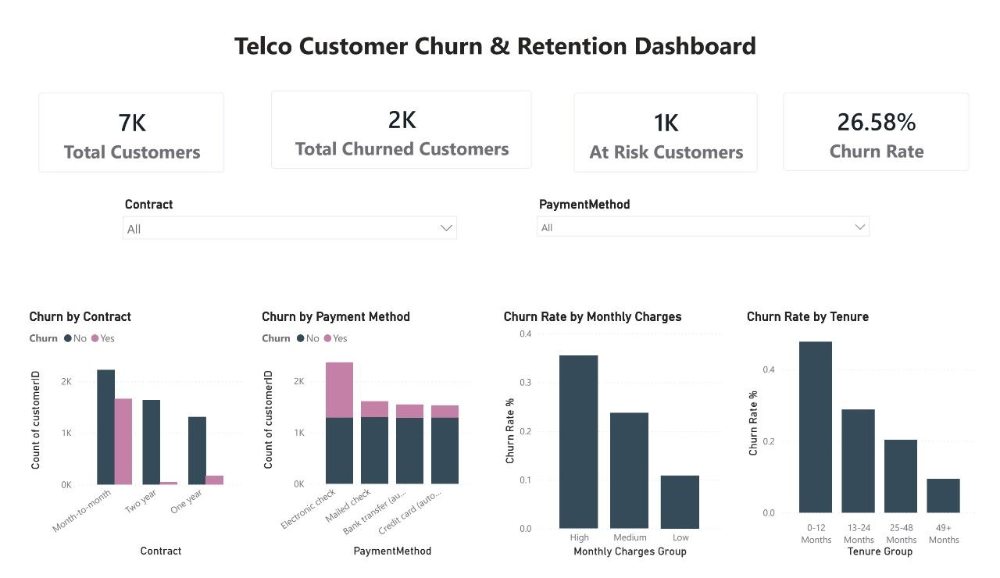

# 📊 Customer Churn Analysis

Turning Customer Data into Retention Strategies

An end-to-end data analytics project exploring customer churn in the telecommunications industry using Python, SQL, and Power BI. The project identifies churn patterns, highlights high-risk customer segments, and translates analytical findings into actionable business recommendations.

## 📸 Dashboard Preview

## 🎥 Dashboard Demo Video

Watch the Customer Churn Analysis dashboard walkthrough:

[▶️ Watch the Dashboard Demo](https://drive.google.com/file/d/1xNiKYOBmy8ngsfm_9yboJO-zwEOy8NHm/view?usp=drivesdk)

## 🎯 Business Objectives

* Measure overall customer churn and identify high-risk segments.
* Analyze the relationship between contract types and customer churn.
* Investigate churn patterns across different payment methods.
* Identify opportunities to improve customer retention.
* Support data-driven business decisions through interactive visualizations.

## 🛠️ Tools & Technologies

| Tool       | Purpose                                  |
| ---------- | ---------------------------------------- |
| Python     | Data preprocessing and analysis          |
| Pandas     | Data cleaning and manipulation           |
| Matplotlib | Exploratory data visualization           |
| SQL        | Data querying and analytical exploration |
| Power BI   | Interactive dashboard and KPI reporting  |
| GitHub     | Project documentation and portfolio      |

## 🧹 Data Preparation

The dataset was prepared for analysis using Python and Pandas.

* Loaded and inspected the customer dataset.
* Converted TotalCharges to a numeric data type.
* Identified and handled invalid and missing values.
* Removed records with missing TotalCharges values.
* Prepared the cleaned data for further analysis and visualization.

## 📈 Key Performance Indicators

| KPI                | Result |
| ------------------ | -----: |
| Total Customers    |  7,032 |
| Churned Customers  |  1,869 |
| Overall Churn Rate | 26.58% |
| At-Risk Customers  |  1,138 |

## 🔍 Key Findings

1. Contract Type

* Month-to-month customers have a churn rate of approximately 42.71%.
* One-year contract customers have a churn rate of approximately 11.28%.
* Two-year contract customers have a churn rate of approximately 2.85%.

2. Payment Method

* Electronic check users have a churn rate of approximately 45.29%, making this payment segment a priority for further investigation.

3. Customer Retention

* Customers with shorter tenure and higher monthly charges are important segments to investigate when designing targeted retention initiatives.

## 💡 Business Recommendations

* Promote long-term contracts: Offer suitable incentives to encourage customers to choose longer contract periods.
* Investigate payment-related churn: Understand the reasons behind the high churn rate among electronic check users.
* Strengthen customer onboarding: Improve the early customer experience and engagement during the first months.
* Develop targeted retention campaigns: Prioritize high-risk customer segments with relevant offers and support.
* Monitor performance: Track churn KPIs regularly to evaluate retention initiatives and support continuous improvement.

## 📂 Project Files

* [Python Analysis — Churn_analysis.py](Churn_analysis.py)
* [SQL Queries — Customer_churn_analysis.sql](Customer_churn_analysis.sql)
* [Power BI Dashboard — PBIX](Telco_customer_churn_Dashboard.pbix)
* [Dashboard PDF](Telco_customer_churn_Dashboard.pdf)
* [Full Project Report](Customer_Churn_Analysis_Report_with_Dashboard.pdf)
* [Dashboard Image](Customer_Churn_Dashboard.jpg)

## 📝 Conclusion

This project demonstrates how Python, SQL, and Power BI can be combined to analyze customer churn, uncover meaningful behavioral patterns, and develop business recommendations. The findings help highlight customer segments that may benefit from focused retention strategies and ongoing performance monitoring.

## 👩‍💻 Author

Rogina Wagih

Data Analytics Portfolio Project
